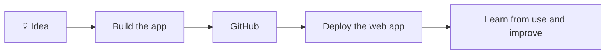

  

# Rohit Mahajan

[Resume](https://rohitisavailable.github.io/Resume/) · [LinkedIn](https://linkedin.com/in/rohitmahajan12/) · [Email](mailto:rohitmahajan1202@gmail.com) · [Repositories](https://github.com/Rohitisavailable?tab=repositories)

---

## About me

I build practical web applications and learn by taking them from idea to deployment. I’m especially interested in thoughtful user experiences, useful AI features, and how web apps work end to end.

- 🧩 Frontend and backend development
- 🤖 Browser-based and hosted AI integrations
- ☁️ Learning cloud deployment and AWS fundamentals

## How I build

## Skills and tools

| Area | Skills and tools |
| --- | --- |
| Languages | Python, JavaScript, HTML, CSS |
| Frameworks | FastAPI, Flask, Bootstrap |
| Data | PostgreSQL, SQLite |
| AI and browser tech | Supabase, Backboard, WebLLM, WebGPU |
| Tools and deployment | Git, GitHub, VS Code, Render |
| Exploring | AWS and cloud deployment |

## Featured projects

| Project | What it does | Stack |
| --- | --- | --- |
| [Fieldnote](https://github.com/Rohitisavailable/Fieldnote) · [Live app](https://trailside.onrender.com/) | An outdoor reflection app with an on-device model for compatible browsers and an optional hosted fallback. | JavaScript, WebLLM, WebGPU, Supabase |
| [One Thing](https://github.com/Rohitisavailable/one-thing) · [Live app](https://one-thing-3y6j.onrender.com/) | Turns a task into one small next step and lets you save plans. | JavaScript, Supabase, PostgreSQL, Backboard |
| [PassThrough](https://github.com/Rohitisavailable/PassThrough) | Helps freelancers review receipt details, approve billable expenses, and export invoice-ready CSV lines. | Python, FastAPI, SQLite |
| [PixelWX](https://github.com/Rohitisavailable/pixel-weather) | A pixel-art weather app with city search, forecasts, and animated scenes. | JavaScript, Canvas, Open-Meteo |
| [Community Desk](https://github.com/Rohitisavailable/community-mvp) | A prototype for project-scoped knowledge and source-grounded answers. | Python, SQLite |

## GitHub activity

---

Thanks for stopping by! ✨

