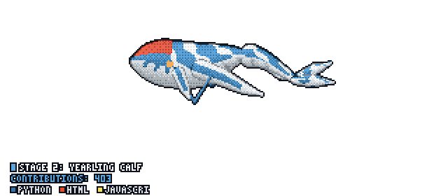

  

  

<h1>Hi! Rohit Mahajan</h1>

<h4>Software Developer & DevOps Engineer</h4>

   
  <strong>My Stack & Tools</strong>
    
  
  
  
  
  
  
  
  
  
  
  
  
  
  
  
  
  
  
  
  
  
  
  
  
  

   
  <strong>Contact me</strong>
    
  

   
  <strong>My Statistics</strong>
    
  

